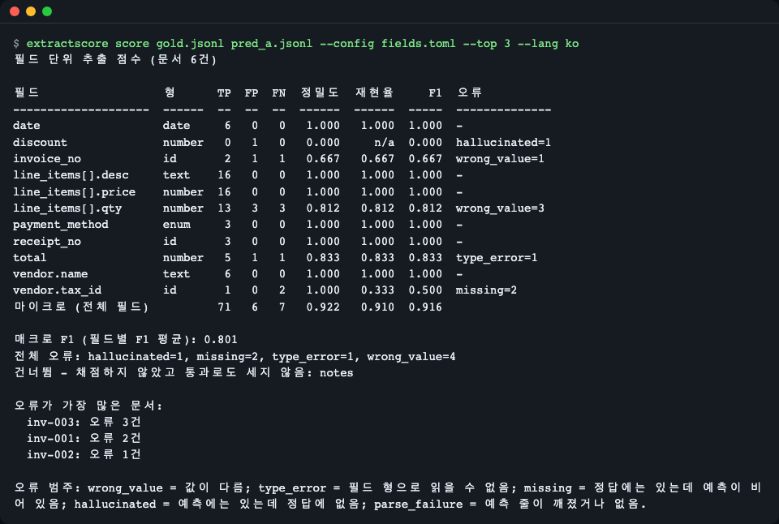
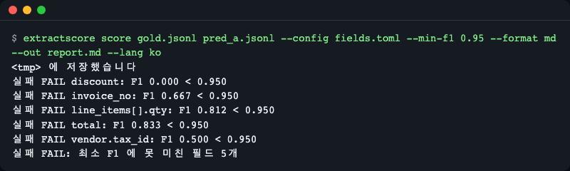
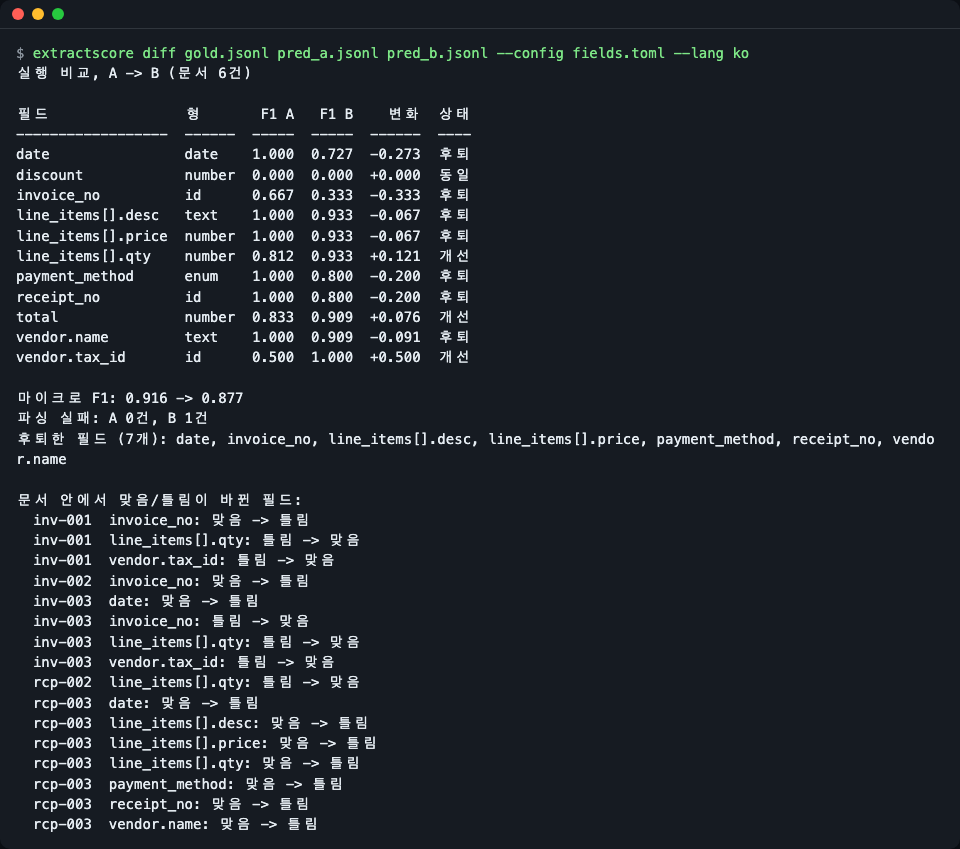
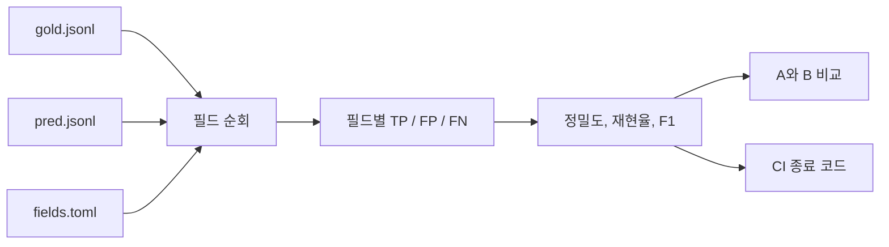

# extractscore

[English](README.md) | **한국어**

문서(송장·영수증·계약서)에서 LLM 으로 뽑은 JSON 의 정확도를 필드 단위 정밀도·재현율·F1 로 재고, 같은 정답 세트로 두 번의 실행(모델·프롬프트 변경 전후)을 비교하는 Python 라이브러리와 CLI 입니다. 런타임 의존성이 없고 Python 3.11 이상이 필요합니다.



*정답 JSONL 과 비교한 필드별 TP/FP/FN, 정밀도, 재현율, F1, 오류 범주.*

## 설치

```bash
uv add git+https://github.com/LeeGyeongPil/extractscore    # 또는: pip install git+https://github.com/LeeGyeongPil/extractscore
```

프로젝트에 추가하지 않고 clone 해서 써 보려면: `git clone https://github.com/LeeGyeongPil/extractscore && cd extractscore && uv run extractscore demo`. uv 가 없다면: `curl -LsSf https://astral.sh/uv/install.sh | sh`.

Python 3.11 이상(표준 라이브러리로 TOML 을 읽습니다). 런타임 의존성 없음.

## 빠르게 시작하기

패키지에는 **연습용 목(mock)** 이 들어 있습니다. 지어낸 송장·영수증 6건, 정답, 그리고 LLM 이 흔히 하는 실수를 흉내 내 **손으로 쓴** 예측 두 벌입니다. 모델을 호출하지 않으므로 오프라인에서 돌아갑니다. 자기 데이터도 정답 파일과 모델 출력만 바꾸면 똑같이 동작합니다.

```bash
uv run extractscore demo      # uv 프로젝트나 clone 안에서. pip 로 설치했다면: extractscore demo
```

A 실행의 점수와 A→B 비교가 출력됩니다. 한 실행만 직접 채점하려면:

```bash
uv run extractscore demo --export my-eval     # 정답·예측·규칙·원문을 복사
uv run extractscore score my-eval/gold.jsonl my-eval/pred_a.jsonl --config my-eval/fields.toml
```

```text
필드                  형      TP  FP  FN  정밀도  재현율     F1  오류
--------------------  ------  --  --  --  ------  ------  -----  --------------
date                  date     6   0   0   1.000   1.000  1.000  -
discount              number   0   1   0   0.000     n/a  0.000  hallucinated=1
invoice_no            id       2   1   1   0.667   0.667  0.667  wrong_value=1
line_items[].desc     text    16   0   0   1.000   1.000  1.000  -
line_items[].price    number  16   0   0   1.000   1.000  1.000  -
line_items[].qty      number  13   3   3   0.812   0.812  0.812  wrong_value=3
payment_method        enum     3   0   0   1.000   1.000  1.000  -
receipt_no            id       3   0   0   1.000   1.000  1.000  -
total                 number   5   1   1   0.833   0.833  0.833  type_error=1
vendor.name           text     6   0   0   1.000   1.000  1.000  -
vendor.tax_id         id       1   0   2   1.000   0.333  0.500  missing=2
마이크로 (전체 필드)          71   6   7   0.922   0.910  0.916

매크로 F1 (필드별 F1 평균): 0.801
전체 오류: hallucinated=1, missing=2, type_error=1, wrong_value=4
건너뜀 - 채점하지 않았고 통과로도 세지 않음: notes
```

(실제 명령은 머리말, 오류가 많은 문서 목록, 오류 범주 설명도 함께 출력하고, 위 표는 그 핵심입니다. 영어 출력은 `--lang en` 을 붙이면 됩니다.)

읽는 법: `total` 은 맞은 값 5개(TP), 틀린 값 1개(FP 1 + FN 1)라서 정밀도와 재현율이 모두 5/6 입니다. `vendor.tax_id` 는 값이 있을 때 틀린 적은 없지만 두 번 빠뜨렸으므로 정밀도 1.0, 재현율 0.33 입니다.

### 내 파일로 채점하기

정답 파일은 줄마다 JSON 객체 하나, `id` 와 정답 필드를 담습니다.

```json
{"id": "inv-001", "invoice_no": "INV-0042", "total": 1250.0, "line_items": [{"desc": "Widget A", "qty": 2, "price": 300.0}]}
```

예측 파일도 같은 모양이고 같은 `id` 를 씁니다. JSON 이 아닌 줄(응답이 잘린 경우 등)은 실행을 멈추지 않고 그 문서의 파싱 실패로 채점됩니다.

### 두 실행 비교와 CI 게이트

```bash
extractscore diff gold.jsonl pred_before.jsonl pred_after.jsonl --config fields.toml --fail-on-regression
extractscore score gold.jsonl pred.jsonl --config fields.toml --min-f1 0.95
```

종료 코드 0 은 통과, 1 은 게이트 실패, 2 는 입력·설정 오류입니다. 바로 쓸 수 있는 GitHub Actions 예시는 [`examples/ci.yml`](examples/ci.yml) 입니다. 이 예시는 PyPI 의 패키지를 `uvx extractscore` 로 바로 실행하므로 따로 설치할 필요가 없습니다.



*`--min-f1 0.95` 는 기준 미만인 필드를 모두 나열하고 종료 코드 1 로 끝납니다.*



*`diff` 는 필드별 F1 의 전후 값과, 문서에서 맞음↔틀림으로 뒤집힌 필드를 보여 줍니다.*

목의 B 실행은 `line_items[].qty` 와 `vendor.tax_id` 를 고치지만 `date` 와 `invoice_no` 는 나빠집니다. 후퇴한 7개 필드의 상당수는 잘린 JSON 한 줄(`rcp-003`) 때문입니다. 깨진 응답 하나가 그 문서의 모든 필드를 깎습니다. 그래서 비교 결과는 합계뿐 아니라 뒤집힌 문서도 보여 줍니다.

## 핵심 개념



- **필드 경로.** 중첩 객체는 `vendor.name`, 목록 항목은 `line_items[].qty` 로 부릅니다. 경로마다 따로 채점합니다.
- **TP / FP / FN.** 맞은 값은 TP. 틀린 값, 또는 필드 형으로 읽을 수 없는 값은 FP 1 + FN 1. 모델이 빠뜨린 값은 FN. 정답에 없는데 모델이 낸 값은 FP. `n/a` 는 0/0 입니다.
- **오류 범주.** `wrong_value`, `type_error`, `missing`, `hallucinated`, `parse_failure`. 몇 개 틀렸는지뿐 아니라 어떤 실수인지 알려 줍니다.
- **형별 비교.** `number`, `date`, `text`, `id`, `enum`, `bool`. `"1,250.00"`, `"$1,250"`, `1250` 은 같은 숫자입니다. id 는 항상 정확히 일치해야 합니다(`INV-215` 와 `INV-0215` 는 다름). 유사 문자열 비교는 설정한 text 필드에만 적용됩니다.
- **목록 항목.** 위치가 아니라 내용으로 짝을 짓습니다(헝가리안 알고리즘, 순수 Python). 순서가 바뀌어도 정답으로 처리하고, 짝이 없는 항목은 누락 1 + 환각 1 입니다.

필드 규칙(`fields.toml` 또는 JSON). 적지 않은 필드는 정답 값에서 형을 추론합니다.

```toml
date_formats = ["%Y-%m-%d", "%m/%d/%Y"]   # 먼저 맞는 형식을 씀

[fields."total"]
type = "number"
tol = 0.01

[fields."line_items[].desc"]
type = "text"
fuzzy = 0.85          # 이 유사도 이상이면 같은 값으로 봄

[fields."notes"]
ignore = true         # 채점하지 않고 '건너뜀' 으로 표시(통과로 세지 않음)
```

## API

```python
from extractscore import evaluate_files, Config
```

| 이름 | 하는 일 | 주요 인자 | 반환 |
|---|---|---|---|
| `evaluate(gold, pred, config=None, *, id_key="id")` | 메모리에 있는 데이터셋 전체를 채점 | 행 목록 또는 `{id: dict}` | `Report` |
| `evaluate_files(gold_path, pred_path, config=None, *, id_key="id")` | 같은 일을 JSONL 두 파일에서 | 경로 | `Report` |
| `compare(gold, pred, config=None)` | 문서 하나를 채점 | dict 두 개 | `DocResult` |
| `diff(report_a, report_b, *, tolerance=0.0)` | 같은 정답으로 낸 두 보고서 비교 | 보고서, 허용할 F1 하락 | `Diff` (`.regressions`, `.improvements`, `.flips`) |
| `check_gates(report, *, min_f1=None, field_min=None)` | CI 기준(전체·필드별) | `min_f1`, `{경로: 최소값}` | `list[GateFailure]` (비어 있으면 통과) |
| `Config.from_file(path)` / `Config.from_dict(data)` / `Config(...)` | 필드 규칙 | `fields`, `match_threshold`, `date_formats`, `empty_as_null` | `Config` |
| `FieldRule(type, tol, fuzzy, casefold, ignore)` | 필드 하나의 규칙 | | `FieldRule` |
| `load_jsonl(path, *, strict, id_key="id")` | JSONL 읽기(UTF-8, 맨 앞 BOM 허용). `strict=False` 면 깨진 줄이 `ParseFailure` 가 됨 | 경로 | id 별 행 `dict` |

`Report` 는 `.fields`(경로별 `FieldStats`: `.precision`, `.recall`, `.f1`, `.counts`), `.micro`, `.macro_f1`, `.parse_failures`, `.skipped`, `.top_docs(n)`, `.to_dict()`, `.to_markdown(lang)` 를 가집니다. counts 는 `.tp`, `.fp`, `.fn`, `.errors`(범주별 개수)를 노출하고, 0/0 인 정밀도·재현율은 `None` 입니다.

예외: `InputError`(정답 데이터나 파일을 읽을 수 없음), `ConfigError`(필드 규칙 오류). 둘 다 `ExtractScoreError` 의 하위 클래스입니다. **예측** 쪽 문제는 예외가 아니라 점수로 처리합니다.

## 사용 예

아래 두 파일은 [`examples/`](examples/) 에 있고 그대로 실행해 확인했습니다.

**한 실행 채점** (`examples/quickstart.py`):

```python
from pathlib import Path

import extractscore
from extractscore import Config, evaluate_files

sample = Path(extractscore.__file__).parent / "sample"
config = Config.from_file(sample / "fields.toml")
report = evaluate_files(sample / "gold.jsonl", sample / "pred_a.jsonl", config)

total = report.fields["total"]
print(f"total: P={total.precision:.3f} R={total.recall:.3f} F1={total.f1:.3f}")
print("type_error:", total.counts.errors["type_error"])
print("micro F1:", round(report.micro.f1, 3))
```

```text
total: P=0.833 R=0.833 F1=0.833
type_error: 1
micro F1: 0.916
```

**두 실행 비교와 게이트 확인** (`examples/compare_runs.py`):

```python
from pathlib import Path

import extractscore
from extractscore import Config, check_gates, diff, evaluate_files

sample = Path(extractscore.__file__).parent / "sample"
config = Config.from_file(sample / "fields.toml")
gold = sample / "gold.jsonl"
a = evaluate_files(gold, sample / "pred_a.jsonl", config)
b = evaluate_files(gold, sample / "pred_b.jsonl", config)

d = diff(a, b)
print("regressed:", ", ".join(d.regressions))
print("improved:", ", ".join(d.improvements))
for failure in check_gates(b, min_f1=0.9, field_min={"total": 0.99}):
    print(f"FAIL {failure.path}: F1 {failure.f1:.3f} < {failure.minimum:.2f}")
```

```text
regressed: date, invoice_no, line_items[].desc, line_items[].price, payment_method, receipt_no, vendor.name
improved: line_items[].qty, total, vendor.tax_id
FAIL date: F1 0.727 < 0.90
FAIL discount: F1 0.000 < 0.90
FAIL invoice_no: F1 0.333 < 0.90
FAIL payment_method: F1 0.800 < 0.90
FAIL receipt_no: F1 0.800 < 0.90
FAIL total: F1 0.909 < 0.99
```

**다른 출력 형식.** `--format json`(영어 키, 스크립트용)과 `--format md`(CI 요약용 Markdown 표). 둘 다 `--out FILE` 과 함께 쓸 수 있습니다.

**언어.** 출력은 영어 또는 한국어입니다: `--lang en|ko`, 없으면 `EXTRACTSCORE_LANG`, 없으면 `LC_ALL`/`LC_MESSAGES`/`LANG`. `ko` 로 시작하지 않으면 영어입니다. JSON 키는 바뀌지 않습니다.

## 언제 쓰나

- 이럴 때: 문서에서 LLM 으로 JSON 을 뽑고, 필드 단위 정밀도·재현율과 같은 정답 세트로의 전후 비교, CI 게이트가 필요할 때. 채점은 결정적이며 모델을 호출하지 않습니다.
- 범위 밖: 추출 자체를 실행하거나 모델을 호출하지 않고, 자유 서술의 품질도 판단하지 않습니다. 준비한 정답 파일과 JSON 을 비교할 뿐입니다.
- 다른 도구가 더 맞는 경우: 범용 LLM 평가 파이프라인([promptfoo](https://github.com/promptfoo/promptfoo), [DeepEval](https://deepeval.com/docs/metrics-json-correctness), [Pydantic Evals](https://pydantic.dev/docs/ai/evals/evaluators/built-in/)), 문서 질의응답 유사도 점수([anls_star](https://pypi.org/project/anls-star/)), 구조화 추출 벤치마크([ExtractBench](https://github.com/ContextualAI/extract-bench)). 이 프로젝트는 범위가 좁아서, 형이 있는 JSON 필드를 목록 짝짓기와 함께 채점하고 두 실행을 비교하는 일 하나만 합니다. 다른 도구의 기능은 바뀌므로 이 문서 대신 각 공식 문서를 확인하세요.

## 한계

숫자를 믿기 전에 읽어 두세요.

- **슬래시 날짜는 월이 먼저입니다.** 기본값에서 `11/03/2026` 은 2026-11-03 으로 읽습니다. 문서가 일을 먼저 쓴다면 `fields.toml` 에서 그 형식을 앞에 두세요: `date_formats = ["%d/%m/%Y", "%Y-%m-%d"]`. 먼저 맞는 형식이 쓰이므로 모호한 날짜는 적은 순서를 따릅니다.
- **유럽식 소수점 쉼표는 인식하지 못합니다.** `"1.250,00"` 은 1250 으로 읽지 않아서, 맞은 값이 `wrong_value` 로 세어집니다. 채점 전에 값을 정리하세요.
- **`id` 를 건질 수 없는 깨진 예측 줄은 버려집니다.** 줄이 잘렸어도 `id` 를 찾을 수 있으면 그 문서는 `parse_failure` 로 채점됩니다. 찾을 수 없으면 그 문서는 예측이 아예 없는 것으로 채점합니다.
- **큰 목록은 느립니다.** 목록 항목 짝짓기는 순수 Python 헝가리안 알고리즘(세제곱 시간)입니다. 한 목록에서 짝 없는 항목이 500개를 넘으면 경고가 나오고, 600개짜리 목록은 시험 환경에서 실행마다 약 2~9초 걸렸습니다.

## 버전·호환성

- [유의적 버전(SemVer)](https://semver.org/lang/ko/)을 따릅니다. 0.x 동안은 마이너 버전에서 API 가 바뀔 수 있고, 바뀌면 [CHANGELOG.md](CHANGELOG.md) 에 적습니다.

## 개발·기여

```bash
git clone https://github.com/LeeGyeongPil/extractscore && cd extractscore
uv run pytest
```

## 라이선스

MIT.
