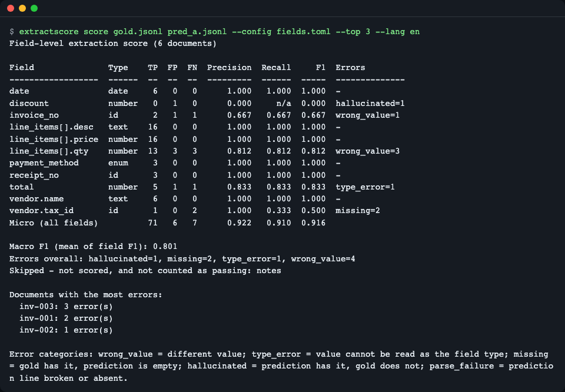
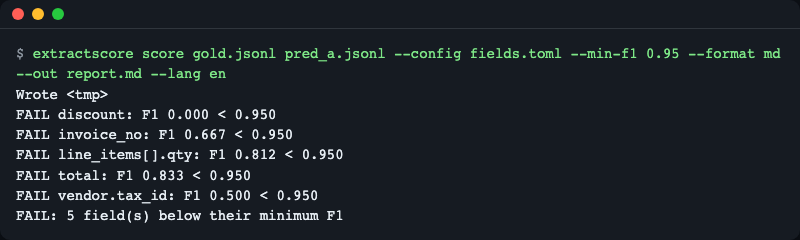
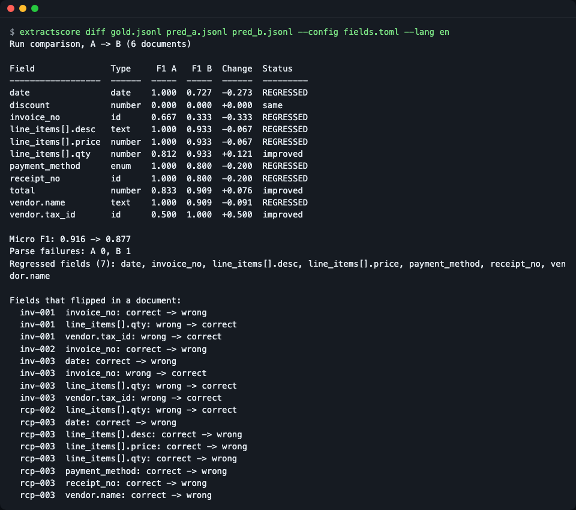
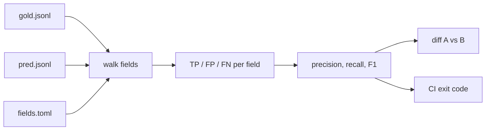

# extractscore

**English** | [한국어](README.ko.md)

Field-level precision, recall and F1 for JSON that an LLM extracted from documents (invoices, receipts, contracts), plus a before/after comparison of two runs on the same gold set. It is a Python library with a matching CLI, has zero runtime dependencies, and needs Python 3.11 or newer.



*Per-field TP/FP/FN, precision, recall, F1 and error categories, scored against a gold JSONL.*

## Install

```bash
uv add git+https://github.com/LeeGyeongPil/extractscore    # or: pip install git+https://github.com/LeeGyeongPil/extractscore
```

To try it from a clone instead: `git clone https://github.com/LeeGyeongPil/extractscore && cd extractscore && uv run extractscore demo`. If you do not have uv: `curl -LsSf https://astral.sh/uv/install.sh | sh`.

Python 3.11+ (it reads TOML with the standard library). No runtime dependencies.

## Quick start

The package ships a **practice mock**: six made-up invoices and receipts, the gold answers, and two sets of predictions that were **written by hand** to imitate typical LLM mistakes. No model is called, so it works offline. Your own data works the same way, with your gold file and your model's output.

```bash
uv run extractscore demo      # inside a uv project or a clone; with pip: extractscore demo
```

That prints the score of run A, then the A to B comparison. To score one run yourself:

```bash
uv run extractscore demo --export my-eval     # copies gold, predictions, rules and source texts
uv run extractscore score my-eval/gold.jsonl my-eval/pred_a.jsonl --config my-eval/fields.toml
```

```text
Field               Type    TP  FP  FN  Precision  Recall     F1  Errors
------------------  ------  --  --  --  ---------  ------  -----  --------------
date                date     6   0   0      1.000   1.000  1.000  -
discount            number   0   1   0      0.000     n/a  0.000  hallucinated=1
invoice_no          id       2   1   1      0.667   0.667  0.667  wrong_value=1
line_items[].desc   text    16   0   0      1.000   1.000  1.000  -
line_items[].price  number  16   0   0      1.000   1.000  1.000  -
line_items[].qty    number  13   3   3      0.812   0.812  0.812  wrong_value=3
payment_method      enum     3   0   0      1.000   1.000  1.000  -
receipt_no          id       3   0   0      1.000   1.000  1.000  -
total               number   5   1   1      0.833   0.833  0.833  type_error=1
vendor.name         text     6   0   0      1.000   1.000  1.000  -
vendor.tax_id       id       1   0   2      1.000   0.333  0.500  missing=2
Micro (all fields)          71   6   7      0.922   0.910  0.916

Macro F1 (mean of field F1): 0.801
Errors overall: hallucinated=1, missing=2, type_error=1, wrong_value=4
Skipped - not scored, and not counted as passing: notes
```

(The command also prints a header, the most-wrong documents and a short error-category legend; the table above is the core of it. For Korean output add `--lang ko`.)

Read it like this: `total` has 5 correct values (TP), 1 wrong value (one FP and one FN), so precision and recall are both 5/6. `vendor.tax_id` was never wrong when present, but the model left it out twice, so precision is 1.0 and recall 0.33.

### Your own files

Gold file, one JSON object per line, with an `id` and the correct fields:

```json
{"id": "inv-001", "invoice_no": "INV-0042", "total": 1250.0, "line_items": [{"desc": "Widget A", "qty": 2, "price": 300.0}]}
```

The prediction file has the same shape, one line per document, using the same `id`. A line that is not valid JSON (for example a truncated response) is scored as a parse failure for that document, it does not stop the run.

### Compare two runs and gate CI

```bash
extractscore diff gold.jsonl pred_before.jsonl pred_after.jsonl --config fields.toml --fail-on-regression
extractscore score gold.jsonl pred.jsonl --config fields.toml --min-f1 0.95
```

Exit code 0 means pass, 1 means a gate failed, 2 means the input or config is invalid. A ready GitHub Actions workflow is in [`examples/ci.yml`](examples/ci.yml). It calls `uvx extractscore`, which works once the package is on PyPI; until then use `uvx --from git+https://github.com/LeeGyeongPil/extractscore extractscore ...`.



*`--min-f1 0.95` lists every field below the bar and exits with code 1.*



*`diff` shows each field's F1 before and after, and which documents flipped between correct and wrong.*

Run B in the mock fixes `line_items[].qty` and `vendor.tax_id` but makes `date` and `invoice_no` worse. Most of the 7 regressed fields come from one cut-off JSON line (`rcp-003`): one broken response lowers every field of that document. That is why the comparison lists the flipped documents, not only the totals.

## Core concepts



- **Field path.** Nested objects become `vendor.name`; items in a list become `line_items[].qty`. Every path is scored on its own.
- **TP / FP / FN.** A correct value is a TP. A wrong value or a value that cannot be read as the field type counts as one FP and one FN. A value the model left out is an FN. A value the gold does not have is an FP. `n/a` means 0/0.
- **Error categories.** `wrong_value`, `type_error`, `missing`, `hallucinated`, `parse_failure`. They tell you what kind of mistake it was, not only how many.
- **Typed comparison.** `number`, `date`, `text`, `id`, `enum`, `bool`. `"1,250.00"`, `"$1,250"` and `1250` are the same number. Ids are always exact: `INV-215` is not `INV-0215`. Fuzzy text matching is on only for the text fields you configure.
- **List items.** Items are paired by content, not by position (Hungarian algorithm, pure Python), so a reordered list is still correct. An item that matches nothing counts as one missing plus one hallucinated.

Field rules (`fields.toml`, or JSON). Fields you do not list get a type inferred from the gold value:

```toml
date_formats = ["%Y-%m-%d", "%m/%d/%Y"]   # first match wins

[fields."total"]
type = "number"
tol = 0.01

[fields."line_items[].desc"]
type = "text"
fuzzy = 0.85          # minimum similarity that still counts as a match

[fields."notes"]
ignore = true         # reported as skipped, never as passing
```

## API

```python
from extractscore import evaluate_files, Config
```

| Name | What it does | Main arguments | Returns |
|---|---|---|---|
| `evaluate(gold, pred, config=None, *, id_key="id")` | Score a whole dataset held in memory | rows or `{id: dict}` | `Report` |
| `evaluate_files(gold_path, pred_path, config=None, *, id_key="id")` | Same, reading two JSONL files | paths | `Report` |
| `compare(gold, pred, config=None)` | Score one document | two dicts | `DocResult` |
| `diff(report_a, report_b, *, tolerance=0.0)` | Compare two reports from the same gold set | reports, allowed F1 drop | `Diff` (`.regressions`, `.improvements`, `.flips`) |
| `check_gates(report, *, min_f1=None, field_min=None)` | CI thresholds, overall and per field | `min_f1`, `{path: min}` | `list[GateFailure]` (empty means pass) |
| `Config.from_file(path)` / `Config.from_dict(data)` / `Config(...)` | Field rules | `fields`, `match_threshold`, `date_formats`, `empty_as_null` | `Config` |
| `FieldRule(type, tol, fuzzy, casefold, ignore)` | Rule for one field path | | `FieldRule` |
| `load_jsonl(path, *, strict, id_key="id")` | Read a JSONL file (UTF-8, a leading BOM is accepted); with `strict=False`, broken lines become `ParseFailure` | path | `dict` of id to row |

`Report` has `.fields` (per-path `FieldStats` with `.precision`, `.recall`, `.f1`, `.counts`), `.micro`, `.macro_f1`, `.parse_failures`, `.skipped`, `.top_docs(n)`, `.to_dict()` and `.to_markdown(lang)`. Counts expose `.tp`, `.fp`, `.fn` and `.errors` (category to number). A precision or recall of 0/0 is `None`.

Errors: `InputError` (the gold data or a file cannot be read), `ConfigError` (invalid field rules), both subclasses of `ExtractScoreError`. Problems in the **predictions** are never exceptions; they are scored.

## Usage examples

Both files below are in [`examples/`](examples/) and were run as written.

**Score one run** (`examples/quickstart.py`):

```python
from pathlib import Path

import extractscore
from extractscore import Config, evaluate_files

sample = Path(extractscore.__file__).parent / "sample"
config = Config.from_file(sample / "fields.toml")
report = evaluate_files(sample / "gold.jsonl", sample / "pred_a.jsonl", config)

total = report.fields["total"]
print(f"total: P={total.precision:.3f} R={total.recall:.3f} F1={total.f1:.3f}")
print("type_error:", total.counts.errors["type_error"])
print("micro F1:", round(report.micro.f1, 3))
```

```text
total: P=0.833 R=0.833 F1=0.833
type_error: 1
micro F1: 0.916
```

**Compare two runs and check gates** (`examples/compare_runs.py`):

```python
from pathlib import Path

import extractscore
from extractscore import Config, check_gates, diff, evaluate_files

sample = Path(extractscore.__file__).parent / "sample"
config = Config.from_file(sample / "fields.toml")
gold = sample / "gold.jsonl"
a = evaluate_files(gold, sample / "pred_a.jsonl", config)
b = evaluate_files(gold, sample / "pred_b.jsonl", config)

d = diff(a, b)
print("regressed:", ", ".join(d.regressions))
print("improved:", ", ".join(d.improvements))
for failure in check_gates(b, min_f1=0.9, field_min={"total": 0.99}):
    print(f"FAIL {failure.path}: F1 {failure.f1:.3f} < {failure.minimum:.2f}")
```

```text
regressed: date, invoice_no, line_items[].desc, line_items[].price, payment_method, receipt_no, vendor.name
improved: line_items[].qty, total, vendor.tax_id
FAIL date: F1 0.727 < 0.90
FAIL discount: F1 0.000 < 0.90
FAIL invoice_no: F1 0.333 < 0.90
FAIL payment_method: F1 0.800 < 0.90
FAIL receipt_no: F1 0.800 < 0.90
FAIL total: F1 0.909 < 0.99
```

**Other output formats.** `--format json` (English keys, stable for scripts) and `--format md` (a Markdown table for a CI job summary), both with `--out FILE`.

**Language.** Output is English or Korean: `--lang en|ko`, else `EXTRACTSCORE_LANG`, else `LC_ALL`/`LC_MESSAGES`/`LANG`; anything not starting with `ko` is English. JSON keys do not change.

## When to use it

- Good fit: you extract JSON from documents with an LLM and want field-level precision/recall, a before/after comparison on the same gold set, and a CI gate. Scoring is deterministic and calls no model.
- Out of scope: it does not run your extraction, call a model, or judge free-text quality. It compares JSON to a gold file you provide.
- Other tools may suit you better when you need a general LLM evaluation pipeline ([promptfoo](https://github.com/promptfoo/promptfoo), [DeepEval](https://deepeval.com/docs/metrics-json-correctness), [Pydantic Evals](https://pydantic.dev/docs/ai/evals/evaluators/built-in/)), a document-QA similarity score ([anls_star](https://pypi.org/project/anls-star/)), or a benchmark for structured extraction ([ExtractBench](https://github.com/ContextualAI/extract-bench)). This project is narrower: it scores one thing, typed JSON fields with list alignment, and compares two runs. Their features change, so check their docs rather than this page.

## Limits

Read these before you trust a number.

- **Slash dates are month first.** By default `11/03/2026` is read as 2026-11-03. If your documents write day first, put that format first in `fields.toml`: `date_formats = ["%d/%m/%Y", "%Y-%m-%d"]`. The first format that parses wins, so an ambiguous date follows the order you give.
- **European decimal commas are not understood.** `"1.250,00"` is not read as 1250, so a correct value is counted as `wrong_value`. Normalise such values before scoring.
- **A broken prediction line without a recoverable `id` is dropped.** If the line is cut off but the `id` can still be found, the document is scored as `parse_failure`. If it cannot, that document is scored as having no prediction at all.
- **Big lists are slower.** List items are paired with a pure-Python Hungarian algorithm (cubic time). A warning appears above 500 unmatched items in one list; a 600-item list took roughly 2 to 9 s across runs on the test machine.

## Version and compatibility

- Follows [Semantic Versioning](https://semver.org/). While the version is 0.x, the API can change in a minor release, and any change is listed in [CHANGELOG.md](CHANGELOG.md).

## Development

```bash
git clone https://github.com/LeeGyeongPil/extractscore && cd extractscore
uv run pytest
```

## License

MIT.
